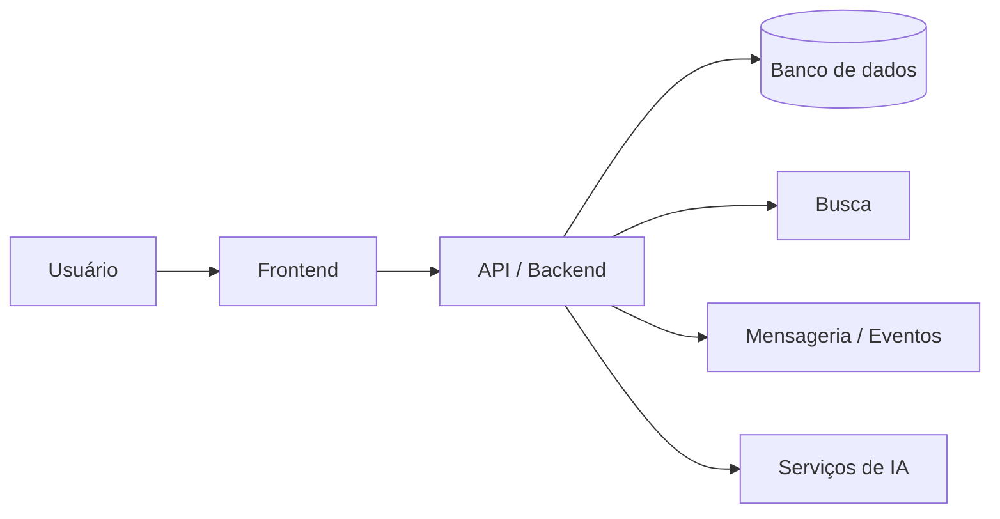

<div align="center">
<!-- NEURAL CORE | Replace Samir-2024 with your GitHub username -->

<a href="https://github.com/Samir-2024">
  
</a>


`> Transformando problemas reais em soluções tecnológicas.`
Desenvolvedor apaixonado por backend, inteligência artificial, aplicações web e integração de sistemas.  
Gosto de transformar ideias em software útil, bem estruturado e sustentável.
Projetos • Stack • Como trabalho • Contato
</div>
---
`> whoami`
```text
┌──────────────────────────────────────────────────────────────┐
│  SAMIR                                                       │
│  Software Developer                                          │
├──────────────────────────────────────────────────────────────┤
│  Foco       Backend • IA • Sistemas • Integrações            │
│  Princípios Código legível • Aprendizado • Impacto real      │
│  Objetivo   Construir tecnologia que resolva problemas       │
└──────────────────────────────────────────────────────────────┘
```
Sou interessado em construir sistemas que conectam pessoas, dados e serviços. Tenho explorado desenvolvimento backend, aplicações web, inteligência artificial, visão computacional e comunicação em tempo real.
> **Minha abordagem:** entender o problema, desenhar a solução, implementar com qualidade e validar o resultado.
⚡ Stack tecnológica
<div align="center">
Linguagens

Frameworks e desenvolvimento web

Dados, IA e infraestrutura

</div>
Também exploro: MediaPipe, Elasticsearch, Apache Kafka, WebSockets, Inertia.js, Keycloak, PWA e APIs REST.
As tecnologias listadas representam áreas de trabalho e estudo; o nível de experiência varia entre elas.
---
🚀 Projetos em destaque
> Ajuste os links e as descrições para refletirem exatamente o estado público de cada repositório.
<table>
<tr>
<td width="50%" valign="top">
🧠 Talk2Signs
Tradução inteligente de Libras e português
Projeto de tradução que explora visão computacional e redes neurais para reconhecer sinais em tempo real.
Reconhecimento de mãos e movimentos
Classificação de sinais com modelo BiLSTM
Processamento com MediaPipe
Integração com aplicação web
`Python` `BiLSTM` `MediaPipe` `TensorFlow` `React`
↗ Ver repositório
</td>
<td width="50%" valign="top">
🏛️ Go.Assaí
Plataforma de serviços digitais
Plataforma voltada à conexão de cidadãos com oportunidades de emprego e serviços digitais.
APIs e serviços de backend
Busca e recuperação de informação
Autenticação e controle de acesso
Integração de componentes
`Go` `Laravel` `React` `Elasticsearch` `Keycloak`
↗ Ver repositório
</td>
</tr>
<tr>
<td width="50%" valign="top">
🤖 Mirai IA
Assistente conversacional com IA
Projeto de assistente conversacional que explora modelos de linguagem, voz e comunicação em tempo real.
Integração com modelo de linguagem local
Comunicação por WebSocket
Fluxo de reconhecimento de fala
Síntese de voz (TTS)
`Go` `LLM` `Ollama` `WebSockets` `STT/TTS`
↗ Ver repositório
</td>
<td width="50%" valign="top">
🛒 Shopping Digital
Experiência web e distribuição Android
Projeto de aplicação web com foco em recursos PWA e empacotamento Android via Trusted Web Activity.
Experiência web instalável
Integração PWA/TWA
Fluxo de distribuição Android
Compatibilidade e publicação
`Laravel` `PWA` `Android` `Web`
↗ Ver repositório
</td>
</tr>
</table>
---
🧬 Como eu trabalho
<div align="center">
01 · ENTENDER	02 · PLANEJAR	03 · DESENVOLVER	04 · VALIDAR
Compreender o problema e o contexto	Definir arquitetura e responsabilidades	Implementar código claro e testável	Medir, testar e documentar
</div>
Princípios de engenharia
Manutenibilidade: nomes claros, responsabilidades bem definidas e estrutura consistente.
Confiabilidade: validar entradas, tratar falhas e escrever testes para fluxos críticos.
Segurança: proteger credenciais, permissões e dados sensíveis.
Documentação: explicar instalação, decisões técnicas e operação.
Aprendizado contínuo: estudar fundamentos e aplicar o conhecimento em projetos reais.
🏗️ Arquitetura e interesses

Este diagrama é ilustrativo: adapte-o para refletir a arquitetura real do projeto que estiver documentando.
Tenho interesse em aprofundar:
Sistemas distribuídos e arquitetura orientada a eventos
Apache Kafka e processamento assíncrono
APIs seguras e integração entre serviços
IA aplicada, visão computacional e NLP
Observabilidade, automação e CI/CD
Modelagem de dados e desempenho
---
📊 GitHub em números
<div align="center">


</div>
Os cards dependem de serviços externos e podem apresentar indisponibilidade ou limites de uso. As métricas variam com a atividade real da conta.
---
🤝 Vamos conversar?
Se você trabalha com desenvolvimento de software, IA ou arquitetura de sistemas, vamos trocar ideias.
<div align="center">
<a href="https://github.com/Samir-2024">
  
</a>
<a href="https://www.linkedin.com/in/SEU_LINKEDIN/">
  
</a>
<br/><br/>
`CODE` · `AI` · `SYSTEMS` · `IMPACT`
“Grandes ideias se tornam realidade com código, disciplina e pessoas certas.”

</div>
